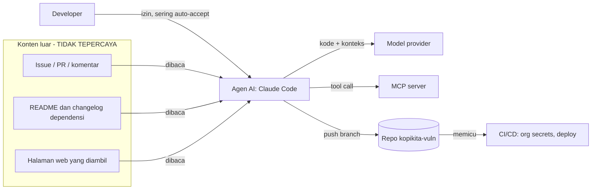

# Peta aset dan batas kepercayaan (contoh jawaban Lab L1.1)

Jawaban pasangan Anda boleh berbeda. Yang dinilai: semua jenis aset tercatat, konten luar
diperlakukan sebagai input tidak tepercaya, dan tiga titik berisiko punya alasan yang jelas.

## 1. Daftar aset

| Jenis aset | Lokasi di repo | Siapa yang bisa mengubah | Dampak bila bocor atau diubah |
| --- | --- | --- | --- |
| Kode | `api/`, `web/` | Developer, agen AI, PR kontributor | Kerentanan masuk produksi |
| Rahasia | `api/config.py` (PAYMENT_API_KEY, SECRET_KEY), `.env`, secret repo | Developer | Penyalahgunaan gateway pembayaran, sesi dipalsukan |
| Dependensi | `api/requirements.txt`, `web/package.json` | Developer, Dependabot, saran AI | Kode pihak ketiga berjalan dengan hak aplikasi |
| Image | `Dockerfile`, `docker-compose.yml` | Developer, workflow | Image berisi CVE, berjalan sebagai root |
| IaC | `infra/main.tf`, `infra/k8s/` | Tim platform | Bucket publik, SSH terbuka |
| Workflow | `.github/workflows/` | Siapa pun yang bisa merge | Akses org secrets dan hak write repo |

## 2. Batas kepercayaan

Garis yang melintasi batas kepercayaan: konten luar ke agen, agen ke MCP server,
agen ke model provider, dan repo ke CI/CD.

## 3. Tiga titik paling berisiko

| No | Titik | Alasan | Kontrol yang akan dipasang |
| --- | --- | --- | --- |
| 1 | Agen membaca issue/PR dari orang luar | Teks di sana bisa menjadi instruksi (prompt injection) | Deny rule, sandbox, review aksi (Hari 2 dan 4) |
| 2 | `.github/workflows/ci.yml` memakai `permissions: write-all` dan mengekspos secret | Agen CI atau PR jahat mewarisi hak tinggi | Izin minimal, pin SHA, OIDC (Hari 3 dan 4) |
| 3 | `api/config.py` menyimpan API key pembayaran di kode | Siapa pun yang bisa membaca repo atau histori mendapat key | Secret scanning, rotasi, env var (Hari 1) |
