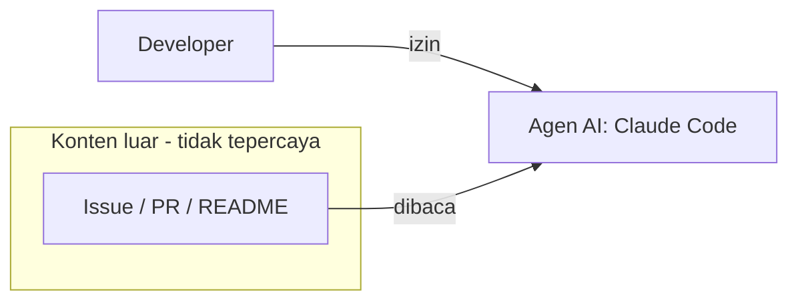

# Peta aset dan batas kepercayaan (Lab L1.1)

Salin berkas ini ke `docs/hasil/L1.1-peta-aset.md`, lalu isi bersama pasangan Anda.

## 1. Daftar aset

| Jenis aset | Lokasi di repo | Siapa yang bisa mengubah | Dampak bila bocor atau diubah |
| --- | --- | --- | --- |
| Kode | | | |
| Rahasia | | | |
| Dependensi | | | |
| Image | | | |
| IaC | | | |
| Workflow | | | |

## 2. Batas kepercayaan

Lengkapi diagram Mermaid di bawah. Tandai garis yang melintasi batas kepercayaan.

## 3. Tiga titik paling berisiko

| No | Titik | Alasan | Kontrol yang akan dipasang (hari ke-) |
| --- | --- | --- | --- |
| 1 | | | |
| 2 | | | |
| 3 | | | |
